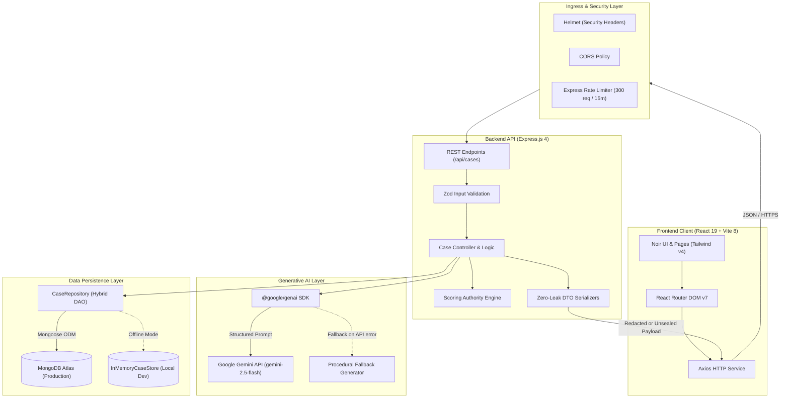
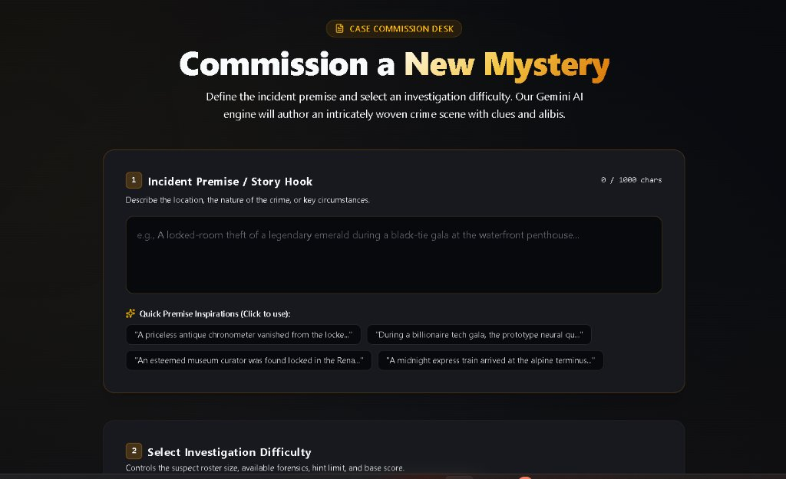
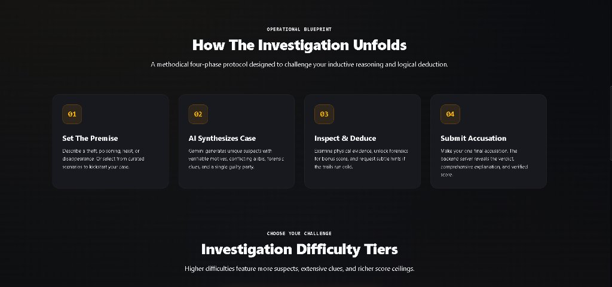
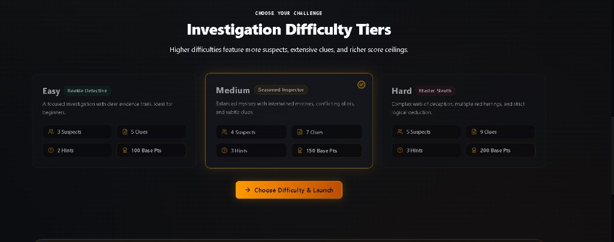
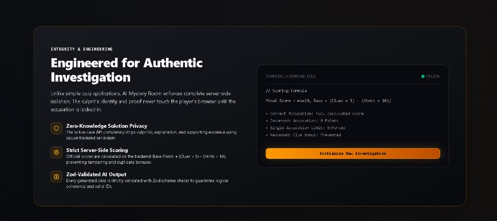
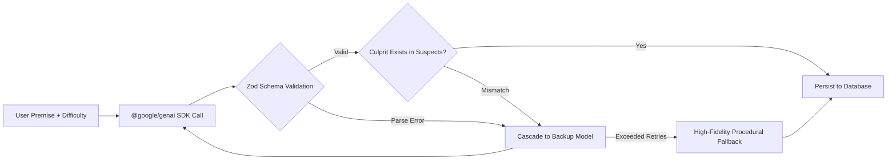

<div align="center">

# 🕵️‍♂️ AI Mystery Room — Neural Detective Bureau

**An intelligent, full-stack detective investigation platform featuring dynamic case synthesis via Google Gemini AI, strict zero-leak server-side solution privacy, interactive forensic clue deduction, and authoritative scoring.**

[](https://react.dev/)
[](https://vitejs.dev/)
[](https://tailwindcss.com/)
[](https://nodejs.org/)
[](https://expressjs.com/)
[](https://www.mongodb.com/atlas)
[](https://ai.google.dev/)
[](https://ai-mystery-room.vercel.app)
[](https://ai-mystery-room-api-0juz.onrender.com/api/health)

[🌐 Live Demo (Vercel)](https://ai-mystery-room.vercel.app) • [📡 Backend Health Check (Render)](https://ai-mystery-room-api-0juz.onrender.com/api/health) • [🏛️ Architecture](docs/architecture/system-architecture.md) • [📸 Screenshots](docs/screenshots/README.md) • [📡 API Reference](#-api-reference)

</div>

---

## 📑 Table of Contents

- [Overview](#-overview)
- [Key Features](#-key-features)
- [Technology Stack](#-technology-stack)
- [System Architecture](#-system-architecture)
- [Screenshots & UI Showcase](#-screenshots--ui-showcase)
- [Zero-Leak Security Architecture](#-zero-leak-security-architecture)
- [Scoring Formula & Difficulty Tiers](#-scoring-formula--difficulty-tiers)
- [AI Synthesis & Reliability Engine](#-ai-synthesis--reliability-engine)
- [API Reference](#-api-reference)
- [Getting Started Locally](#-getting-started-locally)
  - [Prerequisites](#prerequisites)
  - [Backend Setup](#backend-setup)
  - [Frontend Setup](#frontend-setup)
- [Automated Testing Suite](#-automated-testing-suite)
- [Production Deployment Guide](#-production-deployment-guide)
- [Project Structure](#-project-structure)
- [Future Enhancements](#-future-enhancements)
- [Author & Acknowledgements](#-author--acknowledgements)

---

## 🔍 Overview

**AI Mystery Room** is an interactive, full-stack detective game built to challenge player deduction through procedurally generated, solvable murder mysteries and forensic investigations. 

### The Problem It Solves
Traditional digital mystery games suffer from two major architectural flaws:
1. **Static Replay Exhaustion**: Scripted narratives lose value after a single playthrough because clues and culprits never change.
2. **Client-Side Cheat Vulnerability**: Many web games transmit the solution or culprit ID directly to the browser, allowing players to discover the answer simply by opening DevTools or inspecting network payloads.

### The Solution
AI Mystery Room solves these problems by pairing **generative LLM synthesis** with a **Zero-Leak Data Transfer Object (DTO) backend**. The server dynamically creates coherent crime narratives, suspect dossiers, verifiable alibis, forensic clues, and tiered hints using the official Google Gemini SDK. Crucially, the server redacts all solution secrets until a formal, immutable accusation is submitted.

---

## ✨ Key Features

- **Dynamic Case Synthesis**: Generates original, logically sound mysteries on the fly from any custom user prompt or creative inspiration chip using Google Gemini (`gemini-2.5-flash`).
- **Zero-Leak Solution Privacy**: The true culprit identity, forensic explanation, and supporting evidence are stripped on the server and never sent to the browser while an investigation is active.
- **Interactive Evidence Board**: Inspect forensic clues on an evidence board to reveal critical descriptions and earn **+5 bonus points** per discovery.
- **Progressive Hint Bureau**: Unlock tiered, progressive hints when stumped, balanced by a server-enforced **-10 point penalty** per hint.
- **Authoritative Server-Side Scoring**: Computes final scores using strict mathematical boundaries, ensuring client tampering is impossible and incorrect accusations award exactly **0 points**.
- **Three Adaptive Difficulty Tiers**: Tailors suspect count, clue volume, hint allowances, and base point pools across **Easy**, **Medium**, and **Hard** levels.
- **Dual-Mode Persistence (Hybrid DAO)**: Seamlessly persists game sessions to **MongoDB Atlas** in production, with an automatic **In-Memory fallback** for offline or zero-dependency local development.
- **Cinematic Noir UI/UX**: Crafted with a premium dark-charcoal aesthetic (`#08090C`), gold/amber detective accents (`#F5C542`), glowing borders, and responsive design powered by Tailwind CSS v4 and Lucide icons.

---

## 🛠️ Technology Stack

| Layer | Technologies | Purpose |
| :--- | :--- | :--- |
| **Frontend** | React 19, Vite 8, React Router DOM v7 | High-performance Single-Page Application (SPA) |
| **Styling** | Tailwind CSS v4, Lucide React Icons | Atmospheric noir aesthetic, responsive layouts, glowing accents |
| **Network Client**| Axios (v1.21) | Robust HTTP requests with base configuration and timeouts |
| **Backend API** | Node.js (ESM), Express.js 4 | RESTful service architecture with modular controllers |
| **AI Integration** | Google Gen AI SDK (`@google/genai`) | Official Gemini integration with multi-model cascade |
| **Validation** | Zod 3 | Runtime schema validation for requests and LLM JSON outputs |
| **Security** | Helmet, CORS, Express Rate Limit | HTTP security headers, origin protection, API abuse prevention |
| **Database** | MongoDB Atlas, Mongoose 8 | Production document storage with hybrid in-memory fallback |
| **Testing** | Node.js Test Runner (`node:test`, `node:assert`) | Unit and integration testing without heavy testing dependencies |

---

## 🏗️ System Architecture

The application adopts a decoupled, secure multi-tier architecture designed for data integrity, resilience, and zero client leakage.



> 📖 **Deep Dive**: For full sequence diagrams, data models, and architectural specifications, review the [System Architecture Documentation](docs/architecture/system-architecture.md).

---

## 📸 Screenshots & UI Showcase

<div align="center">

### 1. Command HQ & Mission Briefing


<br/>

### 2. Case Commission Desk (AI Synthesis Input)


<br/>

### 3. Operational Blueprint (Four-Phase Protocol)


<br/>

### 4. Investigation Difficulty Tiers (Adaptive Configurations)


<br/>

### 5. Engineered Integrity & Server Security Architecture


</div>

> 📁 High-resolution previews and gallery details are maintained in [`docs/screenshots/README.md`](docs/screenshots/README.md).

---

## 🛡️ Zero-Leak Security Architecture

To guarantee the integrity of every investigation, solution secrets are defended through server-side isolation:

1. **Active Investigation Isolation (`serializeActiveCase`)**:
   - `culpritId` is stripped from every API response.
   - `solutionExplanation` and `supportingEvidence` are omitted.
   - Undiscovered clues have `description: null` returned from the server, making it impossible to uncover clues via DevTools.
   - Undiscovered hints are sliced from the response payload (`hints.slice(0, hintsUsed)`).
2. **Immutable Verdict Transition (`serializeCompletedCase`)**:
   - Solution details are only unsealed after an accusation is recorded and the case status changes to `'solved'` or `'failed'`.
   - Direct requests to `GET /api/cases/:id/result` on an active case return `HTTP 403 Forbidden`.
3. **Anti-Duplication & Single Accusation Lock**:
   - Once an accusation is submitted, subsequent attempts return `HTTP 400 Bad Request`.
   - Repeated inspection of already-discovered clues yields zero duplicate points.
4. **Network & Header Hardening**:
   - Helmet sets secure HTTP headers (`X-Content-Type-Options`, `X-Frame-Options`, `Strict-Transport-Security`).
   - Rate limiting via `express-rate-limit` prevents brute-forcing (300 requests per 15-minute window).

---

## ⚖️ Scoring Formula & Difficulty Tiers

The game uses a deterministic, server-enforced scoring formula:

$$\text{Final Score} = \max\Big(0, \text{Base Points} + (\text{Discovered Clues} \times 5) - (\text{Hints Used} \times 10)\Big)$$

### Rules of Engagement
- **Correct Accusation**: Multiplier of **1.0×** (Player receives the full calculated score).
- **Incorrect Accusation**: Multiplier of **0.0×** (Score is immediately reduced to **0 points**).
- **Floor Boundary**: Score is capped at a minimum of `0` and can never be negative.

### Difficulty Specifications

| Difficulty | Suspects | Clues | Max Hints | Base Points | Perfect Score Potential |
| :--- | :---: | :---: | :---: | :---: | :---: |
| **Easy** | 3 | 5 | 2 | 100 | **125 Points** |
| **Medium** | 4 | 7 | 3 | 150 | **185 Points** |
| **Hard** | 5 | 9 | 3 | 200 | **245 Points** |

---

## 🧠 AI Synthesis & Reliability Engine

The AI generation pipeline combines prompt engineering, strict structural validation, and automated fallbacks:



1. **Official SDK**: Employs `@google/genai` with configurable `GEMINI_MODEL` (defaults to `gemini-2.5-flash`).
2. **Model Cascade**: If generation encounters an error or rate limits, the service cascades through alternative models (`gemini-3.5-flash-lite`, `gemini-3.1-flash-lite`, `gemini-3.5-flash`).
3. **Zod Schema Enforcement**: Output is parsed through `geminiMysteryResponseSchema` to ensure every suspect, clue, hint, and culprit follows exact typing.
4. **Relational Integrity Check**: Automatically verifies that the generated `culpritId` matches a valid suspect in the case dossier.
5. **Procedural Fallback**: If an API key is not configured or network calls fail, the server utilizes a procedural mystery engine so developers can test the full game without an active API key.

---

## 📡 API Reference

Base URL: `/api`

### Endpoints Summary

| Method | Endpoint | Description | Access Level |
| :--- | :--- | :--- | :--- |
| `GET` | `/health` | Server health, DB status, and AI readiness | Public |
| `POST` | `/cases` | Synthesize and create a new mystery | Public |
| `GET` | `/cases/:id` | Fetch case dossier (redacted if active) | Public |
| `POST` | `/cases/:id/clues/:clueId/discover` | Discover a clue (+5 points bonus) | Active Case |
| `POST` | `/cases/:id/hints` | Unlock progressive hint (-10 points penalty) | Active Case |
| `POST` | `/cases/:id/accuse` | Submit final binding accusation | Active Case (Single Use) |
| `GET` | `/cases/:id/result` | Retrieve full solution and final score | Completed Case Only |

<details>
<summary><b>View Detailed Request & Response Examples</b></summary>

#### 1. Create Mystery (`POST /api/cases`)
```bash
curl -X POST http://localhost:5000/api/cases \
  -H "Content-Type: application/json" \
  -d '{"premise": "A rare emerald vanished from the estate vault.", "difficulty": "medium"}'
```
**Response (201 Created)**:
```json
{
  "success": true,
  "data": {
    "id": "6724...",
    "title": "The Emerald Enigma",
    "premise": "A rare emerald vanished from the estate vault.",
    "story": "During the annual gala...",
    "difficulty": "medium",
    "suspects": [
      {
        "id": "suspect_1",
        "name": "Arthur Vance",
        "description": "Chief Curator",
        "motive": "Mounting debts",
        "alibi": "In the archives"
      }
    ],
    "clues": [
      {
        "id": "clue_1",
        "title": "Shattered Glass",
        "description": null,
        "isDiscovered": false
      }
    ],
    "discoveredClueIds": [],
    "hintsUsed": 0,
    "maxHints": 3,
    "hints": [],
    "status": "active"
  }
}
```

#### 2. Submit Accusation (`POST /api/cases/:id/accuse`)
```bash
curl -X POST http://localhost:5000/api/cases/6724.../accuse \
  -H "Content-Type: application/json" \
  -d '{"suspectId": "suspect_2"}'
```
**Response (200 OK)**:
```json
{
  "success": true,
  "message": "Accusation correct! Case solved.",
  "data": {
    "id": "6724...",
    "status": "solved",
    "accusationId": "suspect_2",
    "culpritId": "suspect_2",
    "culprit": {
      "id": "suspect_2",
      "name": "Elena Rostova",
      "description": "Visiting Art Historian"
    },
    "isCorrect": true,
    "finalScore": 175,
    "solutionExplanation": "Elena used the service elevator...",
    "supportingEvidence": [
      "Frayed velvet thread matched Elena's shawl.",
      "Security logs indicate keycard was used."
    ]
  }
}
```

</details>

---

## 🚀 Getting Started Locally

### Prerequisites
- **Node.js**: v18.0.0 or higher
- **npm**: v9.0.0 or higher
- **Git**

---

### Backend Setup

1. Open a terminal and navigate to `server/`:
   ```bash
   cd server
   ```
2. Install dependencies:
   ```bash
   npm install
   ```
3. Configure environment variables:
   ```bash
   cp .env.example .env
   ```
   Edit `server/.env` with your settings:
   ```env
   PORT=5000
   MONGODB_URI=your_mongodb_connection_string
   GEMINI_API_KEY=your_gemini_api_key
   GEMINI_MODEL=gemini-2.5-flash
   CLIENT_URL=http://localhost:5173
   ```
   > 💡 **Offline Development**: If `MONGODB_URI` or `GEMINI_API_KEY` are omitted, the server operates in resilient development mode with in-memory persistence and procedural mystery generation.

4. Check or clear port 5000 (if needed):
   ```bash
   npm run check-port
   npm run kill-port
   ```
5. Start the backend server:
   ```bash
   npm run dev
   # Or for production start:
   npm start
   ```
   The backend will be live at `http://localhost:5000`.

---

### Frontend Setup

1. Open a second terminal and navigate to `client/`:
   ```bash
   cd client
   ```
2. Install dependencies:
   ```bash
   npm install
   ```
3. Configure environment variables:
   ```bash
   cp .env.example .env
   ```
   Verify the API URL in `client/.env`:
   ```env
   VITE_API_URL=http://localhost:5000/api
   ```
4. Start the Vite development server:
   ```bash
   npm run dev
   ```
5. Open your browser and navigate to:
   ```text
   http://localhost:5173
   ```

---

## 🧪 Automated Testing Suite

The backend includes a comprehensive, zero-dependency test suite running on Node's native test runner (`node:test` and `node:assert`).

```bash
cd server
npm test
```

### Test Coverage Highlights
- **Scoring Formulas**: Evaluates exact scores across Easy, Medium, and Hard configurations.
- **Accusation Scenarios**: Validates correct accusation calculations, incorrect accusation zero-scores, and score floors ($0$).
- **Zero-Leak DTO Privacy**: Guarantees that `culpritId`, `solutionExplanation`, and `supportingEvidence` are stripped during active investigations.
- **Zod Schema Boundaries**: Validates premise strings, difficulty enumerations, and suspect ID schemas.

---

## 🚢 Production Deployment Guide

### Deploying Frontend (Vercel)
1. Push your repository to GitHub.
2. Sign in to [Vercel](https://vercel.com/) and click **Add New Project**.
3. Select your repository and set the **Root Directory** to `client`.
4. Configure Build Settings:
   - Framework Preset: `Vite`
   - Build Command: `npm run build`
   - Output Directory: `dist`
5. Under **Environment Variables**, add:
   - `VITE_API_URL`: `https://ai-mystery-room-api-0juz.onrender.com/api`
6. Click **Deploy**.

### Deploying Backend (Render)
1. Sign in to [Render](https://render.com/) and click **New +** → **Web Service**.
2. Connect your GitHub repository and set the **Root Directory** to `server`.
3. Configure Service Settings:
   - Environment: `Node`
   - Build Command: `npm install`
   - Start Command: `node server.js`
4. Under **Environment Variables**, add:
   - `PORT`: `5000`
   - `MONGODB_URI`: Your MongoDB Atlas connection string
   - `GEMINI_API_KEY`: Your Google Gemini API Key
   - `GEMINI_MODEL`: `gemini-2.5-flash`
   - `CLIENT_URL`: Your deployed Vercel frontend URL
5. Click **Create Web Service**.

---

## 📂 Project Structure

```text
AI-Mystery-Room/
├── .github/                     # GitHub workflows and issue templates
├── client/                      # Frontend Application (React 19 + Vite 8)
│   ├── public/                  # Static assets & custom favicon
│   │   ├── favicon.svg          # Custom gold magnifying glass favicon
│   │   └── icons.svg            # SVG icon symbols
│   ├── src/
│   │   ├── assets/              # Static media
│   │   ├── components/          # Reusable UI components
│   │   │   ├── Button.jsx       # Custom styled noir button
│   │   │   ├── ClueCard.jsx     # Clue card with discovery state
│   │   │   ├── DifficultyCard.jsx # Tier selector cards
│   │   │   ├── Footer.jsx       # Application footer
│   │   │   ├── LoadingScreen.jsx# Pulsing deduction loader
│   │   │   ├── Navbar.jsx       # Header & brand badge
│   │   │   ├── ProtectedError.jsx # Boundary error display
│   │   │   └── SuspectCard.jsx  # Suspect profile card
│   │   ├── pages/               # Application view routes
│   │   │   ├── Home.jsx         # Landing page & overview
│   │   │   ├── CreateMystery.jsx# Premise input & generation
│   │   │   ├── InvestigationRoom.jsx # Active evidence board
│   │   │   └── Results.jsx      # Verdict & debrief view
│   │   ├── services/
│   │   │   └── api.js           # Axios API service client
│   │   ├── App.jsx              # Route configuration
│   │   ├── index.css            # Tailwind theme & noir classes
│   │   └── main.jsx             # Entry mount
│   ├── .env.example             # Frontend environment template
│   ├── package.json
│   └── vite.config.js
├── docs/                        # Project documentation
│   ├── architecture/
│   │   └── system-architecture.md # In-depth architectural spec
│   └── screenshots/
│       └── README.md            # Visual showcase & gallery
├── server/                      # Backend REST API (Node.js + Express)
│   ├── config/
│   │   └── db.js                # MongoDB connection & DNS resilience
│   ├── controllers/
│   │   └── caseController.js    # Case lifecycle & DTO serializers
│   ├── middleware/
│   │   └── errorHandler.js      # Centralized error handler
│   ├── models/
│   │   └── Case.js              # Mongoose schema & hybrid repository
│   ├── routes/
│   │   └── caseRoutes.js        # Express REST endpoints
│   ├── scripts/
│   │   └── portManager.js       # Port diagnostics & killer
│   ├── services/
│   │   └── geminiService.js     # @google/genai SDK integration
│   ├── tests/                   # Native test runner suites
│   │   ├── apiIntegration.test.js
│   │   └── scoringAndSecurity.test.js
│   ├── utils/
│   │   └── scoring.js           # Mathematical scoring engine
│   ├── validators/
│   │   └── caseValidator.js     # Zod runtime schemas
│   ├── app.js                   # Express application setup
│   ├── server.js                # Entry point & port listeners
│   ├── .env.example             # Backend environment template
│   └── package.json
├── .env.example                 # Root environment reference
├── .gitignore                   # Multi-tier secret exclusions
├── LICENSE                      # MIT License
├── SPEC.md                      # Technical specifications
└── README.md                    # Primary repository documentation
```

---

## 🔮 Future Enhancements

- **Spatial Audio & Sound Design**: Adding atmospheric noir ambient audio, typewriter effects for clues, and dramatic verdict sound cues.
- **Multiplayer Co-Op Deduction**: Shared investigation rooms using WebSockets for collaborative detective teams.
- **Time Attack Mode**: An optional countdown clock per investigation tier for high-stress deduction.
- **Exportable Case File**: One-click generation of a downloadable, confidential forensic PDF debrief.
- **Global Detective Leaderboard**: Persistent high-score rankings tracked across difficulty tiers.

---

## 👤 Author & Acknowledgements

- **Lead Engineer**: [Rizwan](https://github.com/Rizwan-edu)
- **Workshop**: Built for the **NxtWave Build Your Own AI Investigation Room** Workshop.
- **AI Platform**: Powered by **Google Gemini** (`@google/genai`).

---

<div align="center">
  <sub>Constructed with precision, noir atmosphere, and zero-leak security.</sub>
</div>
