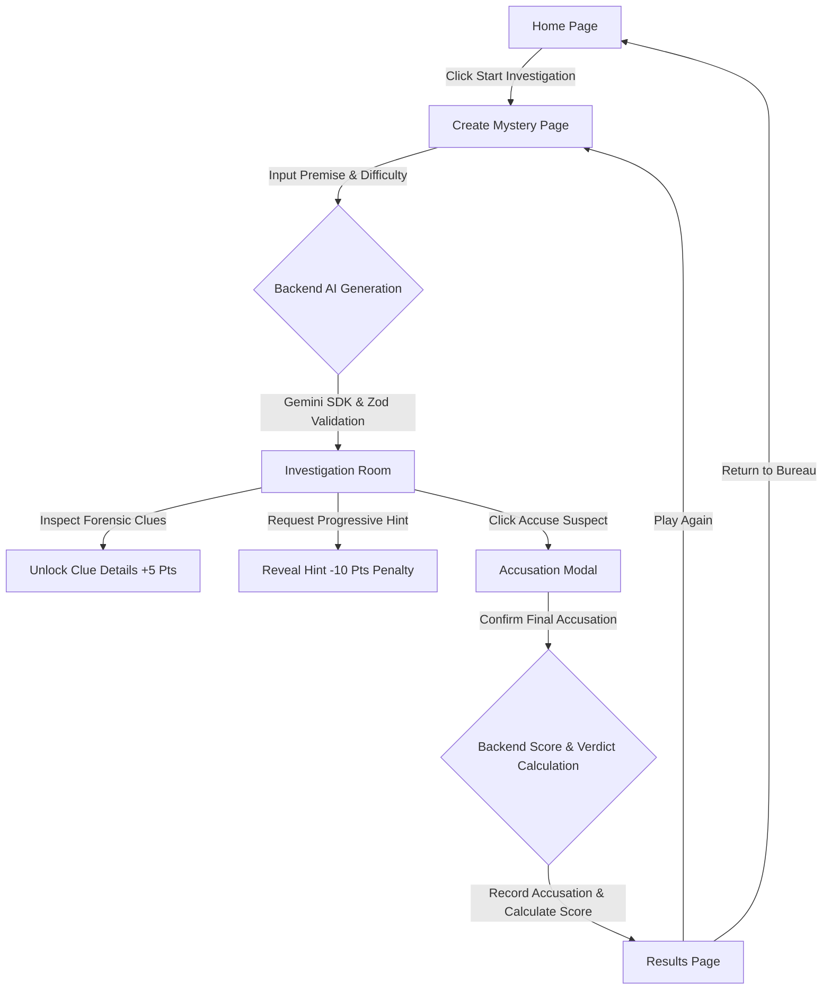

# Technical Specification — AI Mystery Room

## 1. Overview
**AI Mystery Room** is an interactive, full-stack, AI-powered detective investigation web application built for the **NxtWave Build Your Own AI Investigation Room** workshop. Players step into the role of a lead detective, provide or select a mystery premise, and select a difficulty tier. Using Google Gemini via the official `@google/genai` SDK on the backend, the application dynamically synthesizes a solvable mystery complete with unique suspects, verifiable motives, conflicting alibis, physical forensic clues, and progressive hints.

The game challenges players to inspect clues, uncover evidence, manage hint penalties, and submit a single, binding accusation against the culprit. Official scores, solution privacy, and verdict integrity are strictly managed on the server.

---

## 2. Problem Statement
Traditional digital mystery games rely on pre-scripted static branching paths with high replay exhaustion, or they use client-side logic where tech-savvy users can inspect network payloads or local storage to discover the culprit before playing.

Furthermore, naive AI integrations often generate contradictory timelines, unsolvable riddles, or hallucinated suspect details.

**AI Mystery Room solves these challenges by:**
1. **Dynamic Generative AI**: Synthesizing fresh, logically sound cases on demand from any user-provided premise.
2. **Strict Solution Privacy (Zero-Leak DTOs)**: Never transmitting `culpritId`, `solutionExplanation`, or `supportingEvidence` to the client while the investigation is active.
3. **Zod Schema Enforcement**: Structuring and strictly validating AI outputs with retries and fail-safes.
4. **Server-Side Scoring Authority**: Enforcing the exact scoring formula, bonus clue increments, hint penalties, and single-accusation immutability exclusively on the backend.

---

## 3. Technology Stack

### Frontend
- **Framework**: React 19 (ESM + JSX)
- **Bundler & Dev Server**: Vite 8
- **Styling**: Tailwind CSS v4 (with custom atmospheric noir detective theme)
- **Routing**: React Router DOM v7
- **HTTP Client**: Axios
- **Iconography**: Lucide React

### Backend
- **Runtime**: Node.js (ES Modules)
- **Web Framework**: Express.js 4
- **Database ODM**: Mongoose 8 (with resilient fallback for local offline testing)
- **AI SDK**: `@google/genai` (official Google Gen AI SDK)
- **Validation**: Zod 3
- **Security**: Helmet, CORS
- **Rate Limiting**: `express-rate-limit`
- **Environment**: `dotenv`

### Database & Deployment
- **Database**: MongoDB Atlas
- **Frontend Target**: Vercel
- **Backend Target**: Render

---

## 4. User Flows



1. **Premise & Difficulty Selection**:
   - The user inputs a premise (or selects a sample inspiration chip) and selects Easy, Medium, or Hard difficulty.
   - User clicks **Generate Case & Enter Investigation Room**.
2. **Investigation Phase**:
   - User reviews the mystery briefing narrative.
   - Inspects suspect cards (profiles, motives, alibis).
   - Discovers forensic clues (clicking inspect reveals detailed descriptions and flags +5 bonus points).
   - Requests progressive hints if needed (each hint used logs a 10-point deduction).
3. **Accusation Phase**:
   - User opens the Accusation Modal, selects a suspect, reviews the warning, and confirms their choice.
   - The backend validates the accusation, calculates the official score, and seals the case against further edits.
4. **Verdict & Debrief**:
   - The client navigates to the Results page.
   - The server unseals the true culprit identity, forensic explanation, supporting evidence points, and the final score audit.

---

## 5. UI/UX Specifications
- **Palette**:
  - Backgrounds: Deep charcoal and near-black (`#08090d`, `#10121a`, `#151724`)
  - Accents: Gold and amber highlights (`#d4af37`, `#f59e0b`, `#eab308`)
  - Borders: Subtle gold noir borders (`border-amber-500/20`)
  - Badges: Emerald for discovered bonuses, crimson for accusation and culprits, amber for case files
- **Atmosphere**: Radial gradients, subtle glows, confidential dossier typography, and detective badges.
- **Responsiveness**: Fully fluid mobile, tablet, and widescreen layouts.

---

## 6. API Documentation

### Base URL: `/api`

| Method | Endpoint | Description | Auth/Access |
|---|---|---|---|
| `GET` | `/health` | Service health status and timestamp | Public |
| `POST` | `/cases` | Create and synthesize a new mystery | Public |
| `GET` | `/cases/:id` | Fetch case details (redacted if active, full if completed) | Public |
| `POST` | `/cases/:id/clues/:clueId/discover` | Discover a clue and add to player progress | Active case only |
| `POST` | `/cases/:id/hints` | Unlock the next progressive hint | Active case only |
| `POST` | `/cases/:id/accuse` | Submit final accusation and compute official score | Active case only (once) |
| `GET` | `/cases/:id/result` | Retrieve complete verdict, solution, and score | Completed case only |

### Request / Response Payloads:

#### `POST /api/cases`
```json
// Request Body
{
  "premise": "A rare jade artifact vanished from the collector penthouse during the gala.",
  "difficulty": "medium"
}

// Response (201 Created) - Active Case DTO
{
  "success": true,
  "data": {
    "id": "case_65f...",
    "title": "The Enigma of the Vanished Sovereign",
    "premise": "A rare jade artifact...",
    "story": "...",
    "difficulty": "medium",
    "suspects": [
      {
        "id": "suspect_1",
        "name": "Arthur Vance",
        "description": "Chief Curator...",
        "motive": "...",
        "alibi": "..."
      }
    ],
    "clues": [
      {
        "id": "clue_1",
        "title": "Shattered Glass Residue",
        "description": null,
        "isDiscovered": false
      }
    ],
    "discoveredClueIds": [],
    "hintsUsed": 0,
    "maxHints": 3,
    "hints": [],
    "status": "active"
  }
}
```

#### `POST /api/cases/:id/accuse`
```json
// Request Body
{
  "suspectId": "suspect_2"
}

// Response (200 OK) - Completed Case DTO
{
  "success": true,
  "message": "Accusation correct! Case solved.",
  "data": {
    "id": "case_65f...",
    "status": "solved",
    "accusationId": "suspect_2",
    "culpritId": "suspect_2",
    "culprit": {
      "id": "suspect_2",
      "name": "Elena Rostova",
      "description": "..."
    },
    "isCorrect": true,
    "finalScore": 160,
    "solutionExplanation": "...",
    "supportingEvidence": ["..."]
  }
}
```

---

## 7. Database Schema (Mongoose)

```javascript
const caseSchema = new mongoose.Schema({
  title: { type: String, required: true },
  premise: { type: String, required: true },
  story: { type: String, required: true },
  difficulty: { type: String, enum: ['easy', 'medium', 'hard'], required: true },
  suspects: [{
    id: String,
    name: String,
    description: String,
    motive: String,
    alibi: String
  }],
  clues: [{
    id: String,
    title: String,
    description: String
  }],
  hints: [String],
  culpritId: { type: String, required: true },
  solutionExplanation: { type: String, required: true },
  supportingEvidence: mongoose.Schema.Types.Mixed,
  discoveredClueIds: { type: [String], default: [] },
  hintsUsed: { type: Number, default: 0 },
  accusationId: { type: String, default: null },
  finalScore: { type: Number, default: null },
  status: { type: String, enum: ['active', 'solved', 'failed'], default: 'active' },
  createdAt: { type: Date, default: Date.now }
}, { timestamps: true });
```

---

## 8. Difficulty & Scoring Rules

### Exact Difficulty Configurations
| Difficulty | Suspects | Clues | Hints | Base Points |
|---|---|---|---|---|
| **Easy** | 3 | 5 | 2 | 100 |
| **Medium** | 4 | 7 | 3 | 150 |
| **Hard** | 5 | 9 | 3 | 200 |

### Scoring Formula
$$\text{Final Score} = \max\Big(0, \text{Base Points} + (\text{Discovered Clues} \times 5) - (\text{Hints Used} \times 10)\Big)$$

### Business Rules:
1. **Accusation Correct**: Award the calculated score.
2. **Accusation Incorrect**: Award **0 points**.
3. **Clue Bonus**: Each newly discovered clue adds **+5 points**.
4. **Hint Penalty**: Each hint unlocked deducts **-10 points**.
5. **Score Floor**: The score is bounded at **0** and cannot be negative.
6. **Anti-Duplication**: Discovering an already-discovered clue ID awards 0 duplicate points.
7. **Single Accusation Lock**: Once submitted, repeated accusations are rejected (HTTP 400).
8. **Server Authority**: The frontend never calculates or manipulates the official score.

---

## 9. Security & Solution Privacy Requirements
1. **Data Transfer Objects (DTOs)**:
   - `serializeActiveCase()` explicitly omits `culpritId`, `solutionExplanation`, and `supportingEvidence`.
   - Undiscovered clue descriptions are returned as `null`.
   - Only unlocked hints are exposed.
2. **Result Isolation**:
   - Accessing `/api/cases/:id/result` on an active case is denied with HTTP 403 Forbidden.
3. **Defensive Validation**:
   - All inbound payloads are validated via Zod schemas before processing.
4. **Headers & Rate Limiting**:
   - Helmet provides HTTP security headers.
   - `express-rate-limit` prevents brute-forcing and API abuse.

---

## 10. Acceptance Criteria Checklist
- [x] Complete frontend implemented in React + Vite + Tailwind CSS.
- [x] Complete backend implemented in Express + Node.js + Mongoose.
- [x] Gemini AI integration using official `@google/genai` SDK with configurable `GEMINI_MODEL`.
- [x] Zod validation for requests and AI responses with retry and procedural fallback.
- [x] Exact suspect, clue, and hint counts for Easy (3/5/2), Medium (4/7/3), and Hard (5/9/3).
- [x] Server-side score formula enforced with duplicate prevention and single-accusation lock.
- [x] Solution privacy strictly protected until accusation is submitted.
- [x] Automated test suite passing for scoring, validation, DTO privacy, and REST endpoints.
- [x] End-to-end browser investigation workflow verified and documented.
