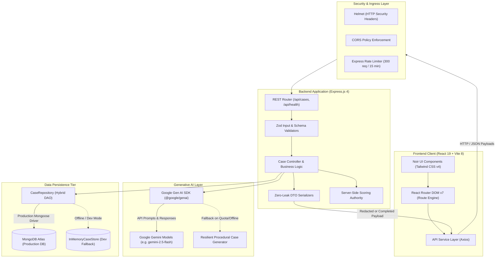

# System Architecture — AI Mystery Room

This document outlines the end-to-end architecture, component relationships, data flow, and security isolation layers of the **AI Mystery Room** platform.

---

## 1. High-Level Component Architecture

The application is structured as a decoupled multi-tier architecture composed of a React 19 Single-Page Application (SPA) frontend and a Node.js / Express.js REST API backend with dual-mode data persistence and Google Gemini AI integration.

---

## 2. Investigation Lifecycle Sequence

The sequence diagram below illustrates the complete lifecycle of an investigation from case creation to final forensic verdict revelation.

```mermaid
sequenceDiagram
    autonumber
    actor Player as Detective (User)
    participant Client as React SPA (Client)
    participant API as Express API Server
    participant Gemini as Google Gemini / AI
    participant DB as MongoDB Atlas / Store

    %% Case Commission
    rect rgb(18, 20, 28)
        Note over Player, Gemini: Phase 1: Case Commission & Dynamic Synthesis
        Player->>Client: Enters premise & selects difficulty
        Client->>API: POST /api/cases { premise, difficulty }
        API->>API: Validate input with Zod schema
        API->>Gemini: Synthesize structured mystery (suspects, clues, culprit, hints)
        Gemini-->>API: Validated JSON mystery payload
        API->>DB: Persist complete case document
        API->>API: serializeActiveCase() [Strip culprit, solution & undiscovered clues]
        API-->>Client: HTTP 201 Created (Redacted Active Case DTO)
        Client->>Player: Render confidential investigation room
    end

    %% Investigation
    rect rgb(18, 20, 28)
        Note over Player, DB: Phase 2: Active Investigation & Evidence Gathering
        Player->>Client: Inspects forensic clue on evidence board
        Client->>API: POST /api/cases/:id/clues/:clueId/discover
        API->>DB: Record clueId in discoveredClueIds (+5 pts bonus)
        API-->>Client: HTTP 200 OK { clue description, updated progress }
        
        Player->>Client: Requests progressive hint
        Client->>API: POST /api/cases/:id/hints
        API->>DB: Increment hintsUsed (-10 pts penalty)
        API-->>Client: HTTP 200 OK { unlockedHint, remainingHints }
    end

    %% Accusation & Verdict
    rect rgb(18, 20, 28)
        Note over Player, DB: Phase 3: Binding Accusation & Server Verdict
        Player->>Client: Submits accusation against chosen suspect
        Client->>API: POST /api/cases/:id/accuse { suspectId }
        API->>API: Verify single-accusation lock (status == active)
        API->>API: Evaluate suspectId == culpritId
        API->>API: Calculate final score: max(0, Base + Clues*5 - Hints*10)
        API->>DB: Update status to solved/failed & lock case
        API->>API: serializeCompletedCase() [Unseal true culprit, solution, evidence]
        API-->>Client: HTTP 200 OK (Completed Case DTO)
        Client->>Player: Display debrief, score audit & forensic truth
    end
```

---

## 3. Zero-Leak Security & DTO Isolation Model

To prevent technical players from inspecting browser DevTools, network payloads, or client storage to discover the culprit, **solution privacy is strictly enforced on the server**:

1. **Active Investigation Phase (`serializeActiveCase`)**:
   - `culpritId` is completely excluded from the HTTP response payload.
   - `solutionExplanation` is completely excluded.
   - `supportingEvidence` is completely excluded.
   - Undiscovered clues have their `description` set to `null` on the server so unearned clues cannot be extracted from HTML or JSON.
   - Undiscovered hints are truncated from the response array (`hints.slice(0, hintsUsed)`).

2. **Completed Investigation Phase (`serializeCompletedCase`)**:
   - Only after an accusation is formally recorded and the case status transitions to `'solved'` or `'failed'` are the solution explanation, culprit identity, and forensic proofs unsealed.
   - Attempting to query `GET /api/cases/:id/result` before an accusation is submitted returns `HTTP 403 Forbidden`.

3. **Immutability & Anti-Cheat Enforcement**:
   - Accusations are single-use only: repeated calls to `/accuse` are blocked with `HTTP 400 Bad Request`.
   - Repeated discovery of the same clue yields zero duplicate points.
   - Scores cannot fall below `0` points (floor bounded).

---

## 4. Dual-Mode Hybrid Persistence Architecture

The platform implements a resilient **Hybrid Data Access Object (DAO)** pattern through `CaseRepository`:

* **Production Mode**: When `MONGODB_URI` is provided, Mongoose manages connection pools, schema indexing, and persistent storage in MongoDB Atlas.
* **Development / Test Resilience**: If MongoDB Atlas is unavailable or unconfigured during local development, the repository falls back to `InMemoryCaseStore`. This ensures developers can run, test, and preview the full game loop without external infrastructure dependencies.

