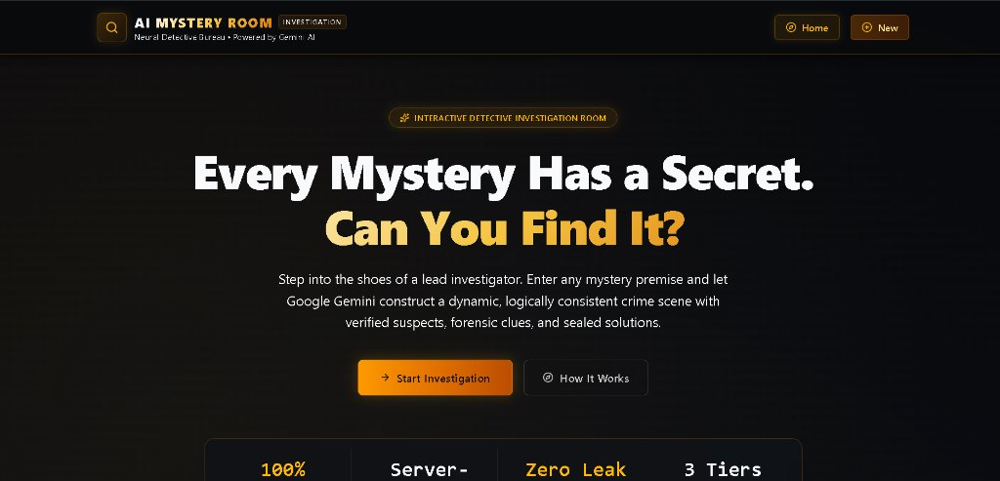
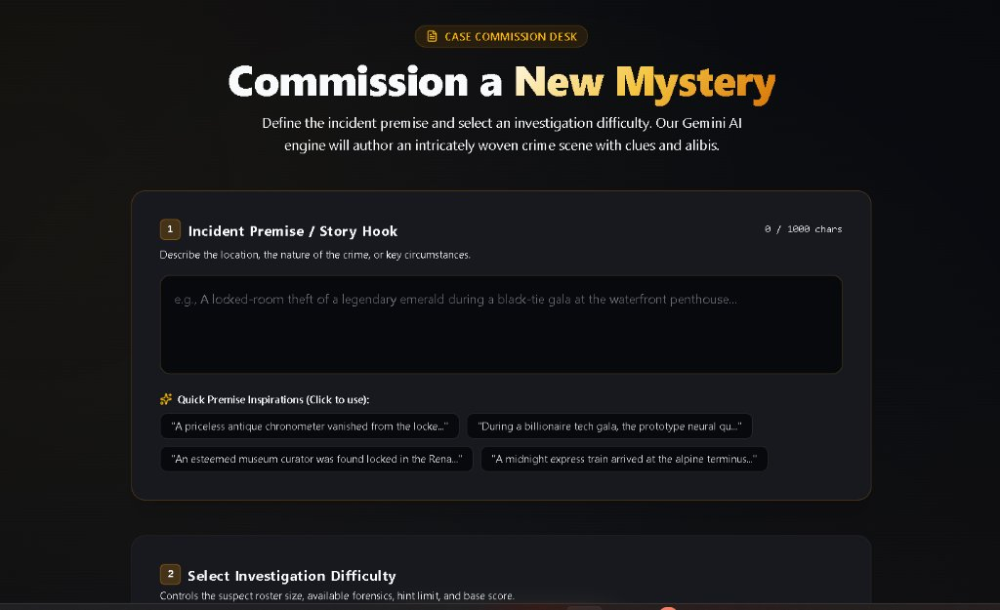
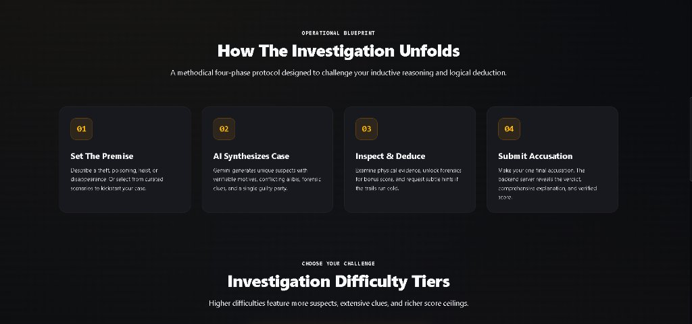
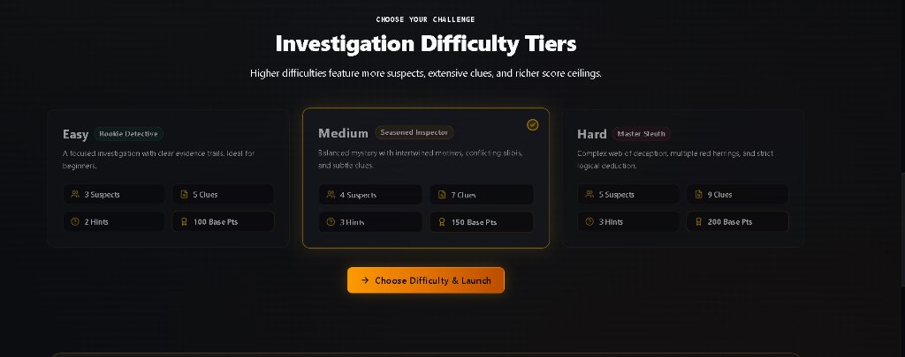
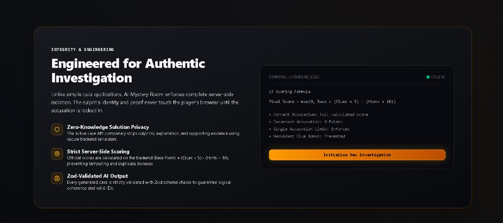

# 📸 UI & Investigation Room Showcase

This gallery documents the user experience and interface design of the **AI Mystery Room** detective application captured from the live application.

---

### 1. Home Page & Mission Command
Atmospheric landing view displaying the noir header, brand badge, mission briefing, and quick investigation launch button.

---

### 2. Case Commission & AI Case Synthesis
Interactive mystery formulation interface featuring custom narrative premise input, one-click creative inspiration chips, and difficulty selector.

---

### 3. Operational Blueprint
A methodical four-phase investigation protocol guiding the detective from premise conception to final binding accusation.

---

### 4. Adaptive Difficulty Tiers
Customizable difficulty configurations (Easy, Medium, Hard) detailing suspect roster sizing, clue volume, hint limits, and base score ceilings.

---

### 5. Engineered Integrity & Server Security Architecture
Interactive terminal displaying the mathematical scoring formula, server-side zero-leak solution privacy, and Zod runtime schema validation.

